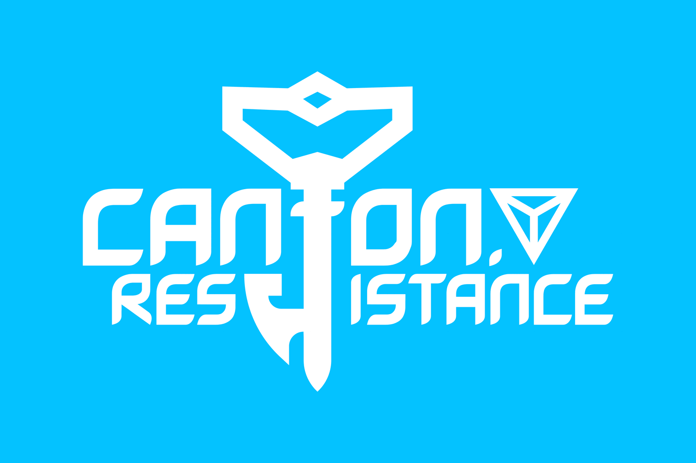

  

# Canton Resistance · 广州抵抗军

> 我们的自由岌岌可危

以广州（Canton）为据点的 Ingress 抵抗军（Resistance）玩家社区。我们在这里维护社区主页、新人引导资料，以及面向 Ingress 拼图任务的开源工具。

*Canton Resistance is a community of Ingress Resistance agents based in Guangzhou (Canton), China. We maintain our community site, onboarding materials, and open-source tools for Ingress banners and missions.*

## 快速入口

| 用途 | 链接 |
| --- | --- |
| 社区主页 | <https://cantonres.github.io/> |
| 加入我们 | <https://join.cantonres.com> |
| 新人教程（速查版） | [Google 文档](https://docs.google.com/document/d/1shHLQZ6esyKoFKrdBJDQ3X4yeU2usq1fAwnmTaWLRc8/edit?usp=sharing) |
| 新人教程（Prime） | [Google 文档](https://docs.google.com/document/d/1axrOoxfVuTbs5SyHPQePCrpcUWbCkxXeP6BgeF75EWQ/edit?usp=sharing) |
| 新人教程（[REDACTED]） | [Google 文档](https://docs.google.com/document/d/1f2UFjHu2_mYuzu7RZVXVNl3ei04Vk35RzWTLINk0UH4/edit?usp=sharing) |

## 关于我们

Canton Resistance 是广州及周边地区 Ingress 抵抗军玩家的交流阵地。社区站点用于发布资料与引导新人；GitHub 组织则存放站点源码和社区自用的开源项目。

我们不是官方组织，也不代表游戏运营方，仅为玩家自发维护的爱好者社区。

## 开源项目

| 仓库 | 说明 |
| --- | --- |
| [cantonres.github.io](https://github.com/cantonres/cantonres.github.io) | 社区主页源码，站点为 <https://cantonres.github.io/>（CSS，Unlicense） |
| [cantonres-jekyll](https://github.com/cantonres/cantonres-jekyll) | 早期基于 Jekyll 的站点源码存档（CSS，最后更新于 2015 年） |
| [ingress-banner-atlas](https://github.com/cantonres/ingress-banner-atlas) | Ingress 拼图（banner）任务档案站：将 Bannergress 上的拼图整理为可检索、可筛选的地图与统计视图（React 19 / Vite 6 / MapLibre GL，MIT）。仅提供本地运行与预览，不含线上部署配置或官方实例 |
| [ingress-gdpr-personal-data-visualizer](https://github.com/cantonres/ingress-gdpr-personal-data-visualizer) | 交互式可视化你自己的 Ingress GDPR 数据导出：地图、热力图、仪表盘；本地优先运行、数据不上传（JavaScript，MIT） |
| [.github](https://github.com/cantonres/.github) | 组织资料仓库：存放组织公开主页所展示的本 README（`profile/README.md`） |

## 参与贡献

- **新玩家**：从「加入我们」入口开始，配合三份新人教程上手。
- **开发者**：欢迎通过对应仓库的 Issue 与 Pull Request 反馈问题、提交改进；动手前请先阅读该仓库的 README 与许可说明。
- **内容与资料**：如发现教程或资料失效，可在相应仓库开 Issue 说明。

## 声明

本组织及其项目均为玩家自发维护的非官方社区与工具，与 Niantic, Inc. 无官方关联。Ingress 为 Niantic, Inc. 的注册商标，相关权利归其所有。Ingress 拼图数据来源为 Bannergress，Banner Atlas 为爱好者维护的非官方档案站。
